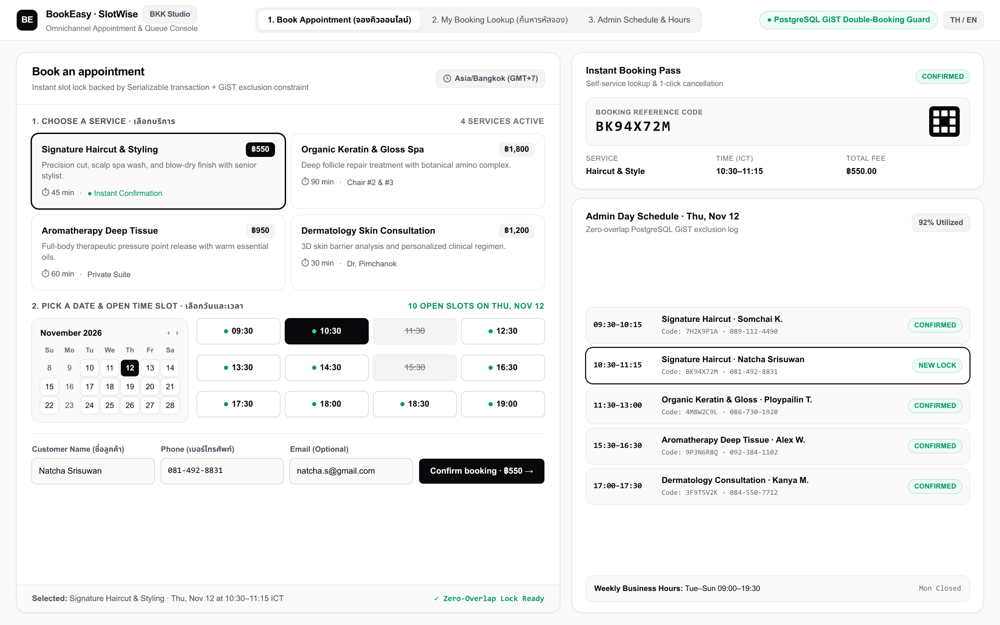

# BookEasy (SlotWise) — Commercial Appointment Booking & Schedule Console

[](https://github.com/peemphetpimolzzz/appointment-booking/actions/workflows/ci.yml)
[](LICENSE)



A commercial-grade, self-hosted appointment and schedule console tailored for clinics, salons,
wellness studios, and independent consultants. Designed with a Cal.com + Shadcn Minimal + Modern
aesthetic: customers pick a service, select an open time slot, and receive an instant reference
code they can use to look up or cancel their booking. Business owners manage service offerings,
weekly business hours, and the live daily schedule from a unified console.

The headline engineering guarantee is **double-booking prevention at two independent layers**,
so the same time slot can never be sold twice — even under a burst of simultaneous requests.

## Why Businesses & Teams Choose BookEasy

Most clinics and studios juggle bookings over chat apps and paper diaries, making accidental
double-bookings routine. BookEasy delivers a single-origin, container-deployable application
where the "no two customers in the same chair at the same time" rule is enforced directly by
PostgreSQL constraints, not just the UI.

## Key Features

- **Two-layer double-booking prevention**:
  1. **Application layer** — every booking is created inside a PostgreSQL
     `Serializable` transaction that re-checks for overlaps before inserting.
  2. **Database layer** — a PostgreSQL `GiST` `EXCLUDE` constraint (`btree_gist`)
     rejects any two `CONFIRMED` bookings whose time ranges overlap for the same
     service, atomically and regardless of how many requests race. Violations surface
     as a clean **409 Conflict**.
- **Smart Availability Engine** — open slots are computed dynamically from weekly business hours
  minus already-booked intervals minus past times in `Asia/Bangkok` (`UTC+7`).
- **Cal.com-Inspired Customer Storefront** — split-pane service selector, interactive slot grid,
  live booking summary, and instant confirmation pass.
- **Self-Service Lookup & 1-Click Cancel** — customers find and cancel their booking by reference code.
- **Admin Schedule Console** — manage services, configure weekly business hours, and monitor or cancel
  the day's bookings.
- **Single Origin, Zero CORS Hassle** — nginx serves the React SPA and reverse-proxies `/api` to the API container.

## Tech stack

| Layer    | Technology                                              |
| -------- | ------------------------------------------------------- |
| Backend  | Node.js, TypeScript, Express, Prisma ORM                |
| Database | PostgreSQL (`btree_gist` exclusion constraint)          |
| Frontend | React, TypeScript, Vite (Cal.com / Shadcn Design System)|
| Tests    | Vitest (unit), Supertest (integration), Playwright (e2e) |
| Infra    | Docker, Docker Compose (local), Terraform + ECS Fargate (cloud) |
| Cloud    | AWS ECS Fargate, RDS PostgreSQL, ECR, Secrets Manager (OIDC CI/CD) |

## Quick start

```bash
cp .env.example .env
docker compose up --build
```

- Web UI: <http://localhost:8080>
- API health: <http://localhost:8082/api/health>

The API container applies migrations (including the exclusion constraint), seeds sample services
and business hours, then starts serving. The seed is idempotent.

### Try the double-booking guard

```bash
# Create a booking for a future Tuesday slot (03:00 UTC = 10:00 Bangkok)...
curl -s -X POST http://localhost:8082/api/bookings \
  -H 'Content-Type: application/json' \
  -d '{"serviceId":1,"startsAt":"2027-06-08T03:00:00Z","customer":{"name":"A","phone":"0810000000"}}'

# ...then try the same slot again -> HTTP 409, { "error": { "code": "SLOT_TAKEN", ... } }
```

## API

All endpoints are under `/api`. Errors use a consistent envelope: `{ "error": { "code", "message" } }`.

| Method | Path                                          | Description                              |
| ------ | --------------------------------------------- | ---------------------------------------- |
| GET    | `/api/health`                                 | Liveness probe                           |
| GET    | `/api/services?active=true`                   | List services                            |
| GET    | `/api/services/:id`                           | Get a single service                     |
| POST   | `/api/services`                               | Create a service                         |
| PUT    | `/api/services/:id`                           | Update a service                         |
| DELETE | `/api/services/:id`                           | Deactivate a service                     |
| GET    | `/api/business-hours`                         | Weekly schedule                          |
| PUT    | `/api/business-hours`                         | Replace the weekly schedule              |
| GET    | `/api/availability?serviceId=&date=YYYY-MM-DD`| Open slots for a service on a day        |
| POST   | `/api/bookings`                               | Create a booking (transactional, guarded)|
| GET    | `/api/bookings/:code`                         | Look up a booking by code                |
| POST   | `/api/bookings/:code/cancel`                  | Cancel a booking                         |
| GET    | `/api/bookings?date=&serviceId=`              | Admin listing                            |

## Tests

```bash
# Unit tests — pure booking rules (overlap, business hours, slot generation)
docker run --rm -v "$PWD/backend:/app" -w /app node:22-bookworm-slim \
  sh -c "npm ci && npx prisma generate && npm run test:unit"

# Integration tests — Supertest against a dedicated test Postgres
docker compose -f docker-compose.yml -f docker-compose.test.yml run --build --rm integration-tests

# End-to-end — Playwright against the full stack
docker compose up -d --build
docker compose -f docker-compose.yml -f docker-compose.test.yml run --build --rm e2e
```

The integration suite includes a concurrency proof: four identical booking requests are
fired simultaneously and exactly one succeeds (201) while the rest get 409.

## Ports

| Service  | Host port | Notes                                   |
| -------- | --------- | --------------------------------------- |
| Web      | 8080      | `WEB_PORT`                              |
| API      | 8082      | `API_PORT`                              |
| Postgres | 15432     | `DB_PORT` (off 5432 to avoid clashes)   |

## Deploy to AWS

The same container runs in the cloud on **AWS ECS Fargate** behind an Application Load
Balancer, backed by **RDS PostgreSQL**. Infrastructure is defined as Terraform in
[`infra/`](infra/), and the [`Deploy (AWS)`](.github/workflows/deploy.yml) workflow builds
the image, pushes it to ECR, and rolls out a new task revision — authenticating with
**GitHub OIDC**, so no long-lived AWS keys live in the repo. The Prisma `DATABASE_URL` is
stored in **Secrets Manager**, and migrations run automatically on container start.

See [`docs/deployment.md`](docs/deployment.md) for the full walkthrough.

## License

[MIT](LICENSE) — Part of [Peem Phetpimol's portfolio](https://peemphetpimolzzz.github.io) (Fullstack & Cloud Engineer · Test Automation).
